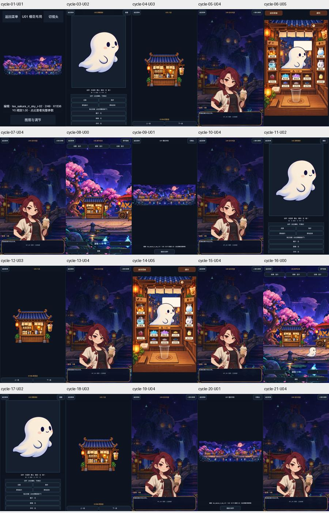
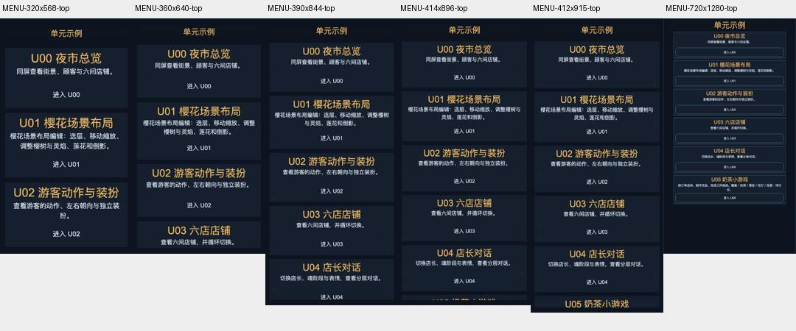

# 本轮审核包

Art v0.2 的76件具体切片与同尺度效果已获批准，250文件身份SHA为 `44140520215db9146c3c0398266d363f08d63024093304df4a908388dec312a8`。获批Art及PSD/审批证据已提交推送 `5f6b4e0`。不重复请求美术批准。

本次两个决定分别如下。批准本页不等于允许发布。

## 1. 客户端整体实现

审核对象为 [FINAL_IDENTITY.json](FINAL_IDENTITY.json) 冻结的源码、构建及Required交付：Main v0.5、U05 v0.3、Gallery v0.5、Resource v0.8。最新集成清单覆盖旧阶段源码，历史版本保留。

无损切片、重复帧共享、按页资源管理、本地分包、统一尺寸接口、竖屏对话、奶茶完整画幅与安全代理、小屏滚动和全文阅读已实际实现。详见 [交付说明](MASTER_SUMMARY.md)、[运行报告及未测项](RUNTIME_VERIFICATION.md)、[Tech最终评审](../../../tech_lead/MINIGAME-ART-OPT-BATCH-20261017-TECH/v0.1/REVIEW.md)。

抖音物理产物38,681,779字节，约36.9MiB，相对20MiB参考仍多17,710,259字节。实际上传/账号限制、DPR2/3、真实安全区及GPU等NOT_TESTED；图集和GPU纹理压缩尚未实施。

**待决定：批准上述具体实现版本，解锁下一适用QA/正式接入验证；或指出需修改部分。**

## 2. 六代表资源压缩样本制作方案

审核对象为 Art [PRODUCTION_PLAN.md](../../../art/MINIGAME-ART-OPT-COMPRESSION-PLAN-20261017/v0.1/PRODUCTION_PLAN.md) 及同目录ART_BRIEF、ASSET_MANIFEST、DELIVERABLE四文件；具体SHA见FINAL_IDENTITY，专业评审见Tech v0.24。

范围为人物底图、场景、店铺主体/招牌、游客帧及奶茶字体六件代表项；最多18个技术候选与6份只读参考、150人分钟预算、0生成式/付费调用。不改变尺寸、UV和视觉构图；无损要求包括透明RGB在内的完整RGBA一致。诊断性有损候选不成为正式档位。平台兼容、实际构建收益必须重新测量，不承诺因此达到20MB。

**待决定：批准该新制作方案，解锁Art/Tech同批预签和代表样本制作。具体样本及效果之后仍需用户审核，不能直接正式接入。**

两项审批依据 [AGENTS.md](../../../../AGENTS.md) 第10节“每个专业阶段的正式Artifact在下游消费前都必须获得用户明确批准”，以及第13节“正式美术图片、母版或切片输出前，Art的资源制作方案须先取得用户明确批准”。这是现有门禁，没有额外增加UI子阶段或自产切片专业复审。
