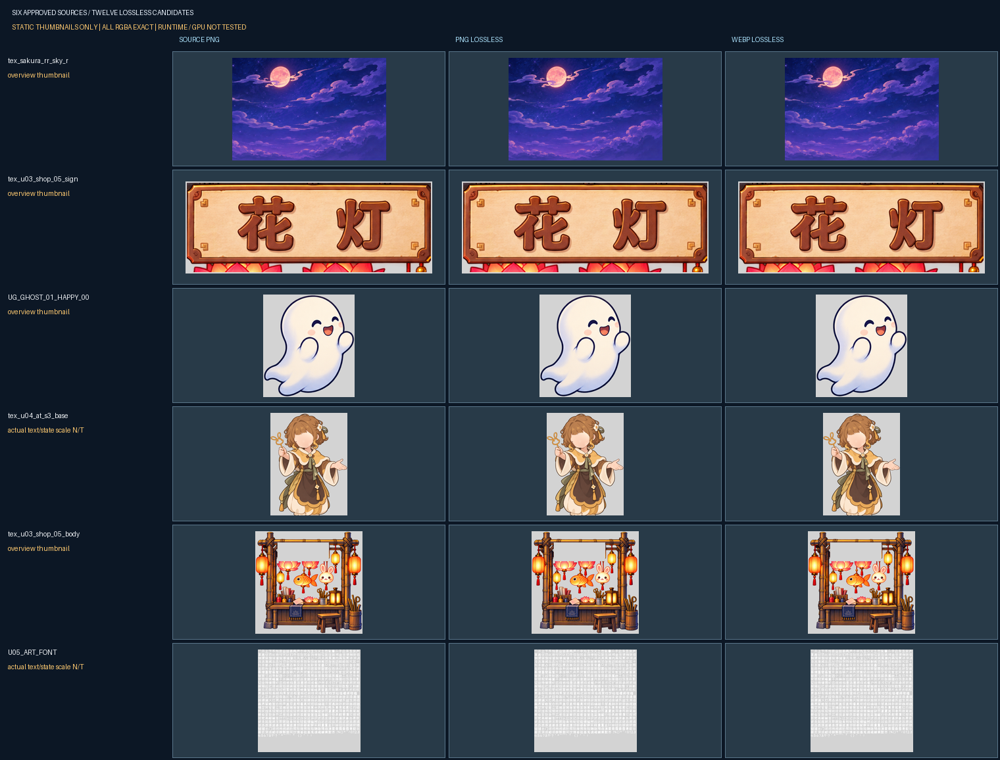

# 本轮待确认的两个具体版本

上一轮整体实现及制作方案已获批准，本次不重复申请。新候选尚未替换正式客户端。

## 1. 正式QA计划 v0.2

请审核[TEST_PLAN.md](../../../qa/MINIGAME-ART-OPT-NEXT-20261017-QA/v0.2/TEST_PLAN.md)及同版CLIENT_TEST_CASES、ENVIRONMENT_INVENTORY、DELIVERABLE。准确SHA见FINAL_IDENTITY，Tech评审为NEXT-TECH/v0.1/QA_PLAN_REVIEW_v0.2.json。

计划覆盖当前冻结实现的Web功能、六竖屏与既有对话横屏、资源/动作/店铺/对话/奶茶、20循环及可测性能。真实平台/设备/DPR2/3等列后续RELEASE；没有可用采样接口的指标明确未测或单项阻塞，不虚构采样。批准本计划后才正式执行，QA报告之后仍单独审核。

**待决定：是否批准这份具体QA计划及用例，解锁正式执行？**

## 2. 六件无损样本 v0.1：12个具体候选与静态对照

请审核Art的[完整样本审阅包](../../../art/MINIGAME-ART-OPT-NEXT-20261017-ART-SAMPLES/v0.1/USER_REVIEW_PACKET.md)、[具体文件身份](../../../art/MINIGAME-ART-OPT-NEXT-20261017-ART-SAMPLES/v0.1/FILE_IDENTITY.json)及同版逐像素/静态投影证据。

六文件PNG合计减少6.2214%，WebP无损减少32.7562%；12候选全RGBA含alpha0隐藏RGB零差。总览仅缩略定位，前三件有相同背景/视窗/源码尺度的单件静态投影，未重组完整场景；人物与字体实际状态/文本显示尺度仍NOT_TESTED。请按这些实际范围判断具体候选，不能把静态批准视为运行效果通过。

首三件在隔离Creator三端实际产物中保持原编码及字节，见[IMPORT_DIAGNOSTIC.json](../../../tech_lead/MINIGAME-ART-OPT-NEXT-20261017-TECH/v0.1/IMPORT_DIAGNOSTIC.json)。未测其余三件导入、最低基础库、真机/GPU与正式运行。Art自身报告中的未测项不因这一局部诊断而全部转为通过。

**待决定：是否批准本包所列六件源对应的12个PNG/WebP无损候选及所展示静态效果，解锁后续具体版本接入验证？可按资产或格式指出退回项。** 两种格式是技术候选，不自动成为运行资源档位；实际发布格式仍须经过对应兼容/接入/QA验证。

当前正式包仍约36.9MiB；隔离仅替换首三WebP后也未达20MiB参考。不承诺本轮样本可以解决全库总包限制，不自行扩成全库或修改画质/内容。

门禁来源：[rules/artifact_contract.md](../../../../rules/artifact_contract.md)的QA要求“正式编码前先提交TEST_PLAN.md…一起通过用户审批”；原实现当时为单元示例，本次转正式QA先补具体计划，不回填旧QA。另[AGENTS.md](../../../../AGENTS.md)第13节规定具体资源效果获用户批准后才能正式接入。两项均为既有门禁，未增加预签或自产效果专业复审。
