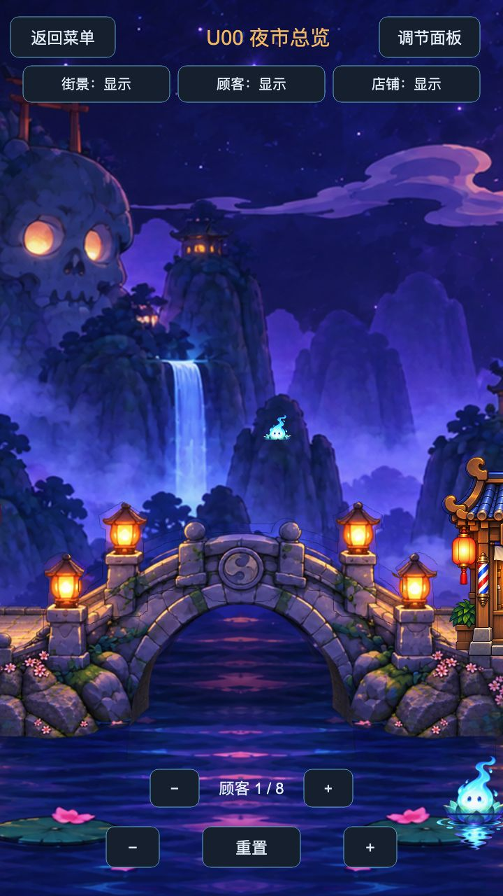

# U00/U01 新桥接入效果 v0.1

已接入用户批准的 Art v0.5。U00/U01 共用21张环境PNG与45个实例，六店与游客沿用；桥身在实体后，前栏杆在实体前。17张非桥图字节和UUID、41个非桥实例身份保持，旧bridge_half已备份后从活动工程退役。累计生图16/16，本轮0次。

## 实际效果

[U01全景](evidence/final_u01_panorama.jpg) · [栏杆遮挡实测](evidence/u01_shop_bridge_occlusion.jpg) · [真实导出布局](evidence/final_u01_export.json) · [本机预览](http://127.0.0.1:8788/)

U01添加、拖动、缩放、镜像、删除、重置和返回重入已执行；重入与退役后最终导出均与初始文本完全相同。U00显隐/游客数量/镜头、共享U04进入及返回通过。Creator3.8.8最终构建与本机HTTP身份匹配，实际浏览器警告/错误为空；目标设备/GPU/小游戏平台性能未测。桥顶细深色轮廓沿批准源图保留，未改图或追加生图。

## 审核范围

本次待确认的是接入后的具体运行效果；v0.5美术资源已按上一条“确认”获批。Master/Tech完成本轮范围检查；身份见RUNTIME_IDENTITY.json，运行证据见FINAL_IAB_VERIFICATION.json。本单元示例当前为USER_REVIEW，未标DONE。
