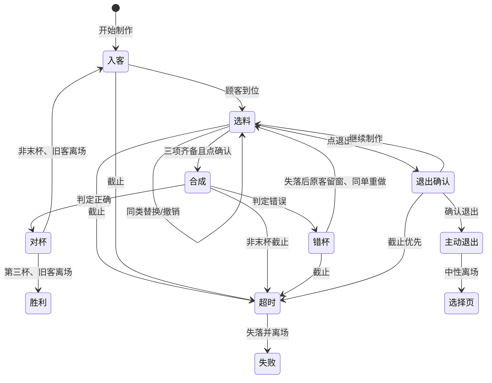

# U05 B 页面状态标注 v0.1

以最终 v4 `deliverables/client/U05-B-FRONTEND-LANDING-20261014/v0.1/evidence/browser-v4-final-workstation.jpg` 为底板与布局参照；本版只用文字标注交互变化，不制作截图。状态图中的结果页继续沿用既有结算视觉。1024×1536 源坐标与 360×640 映射见同版 `UI_SPEC.md`。

选料画面：三槽各摆一个独立对象，工作杯隐藏；订单气泡目标杯整体缩至约 118×140。合成画面：三对象移向工作杯，杯后/内容/前壁正确遮挡。错杯：杯清空，失落脸短动画，顾客不离场。对杯：开心脸，旧客身体/脸在窗口 mask 内完整左移出场，下一位从左侧完整入场；气泡在离场开始收起，下一位到位后才揭示新目标。超时失落后完整离场，主动退出中性完整离场，再显示既有失败/菜单画面。窗口按 Art 方案 `[260,278,490,505]`，角色停靠 x309、宽332，完整离场终点 x=`260-332=-72`，位移 -381 源像素；仅同版修订窗口边界时按公式重算，不能用淡出遮半身。全部过渡中时钟持续运行，实际业务判定以确认时刻为准。
